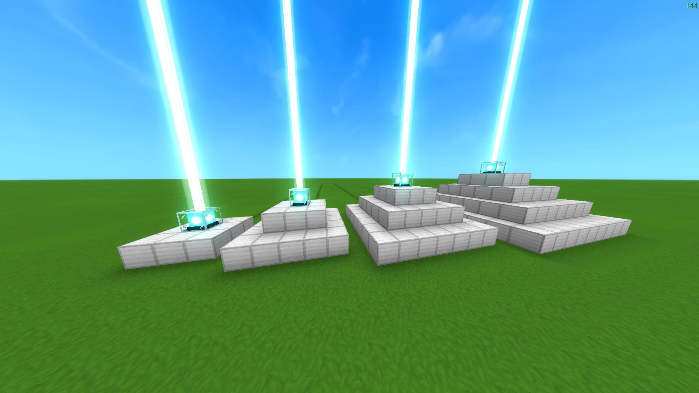
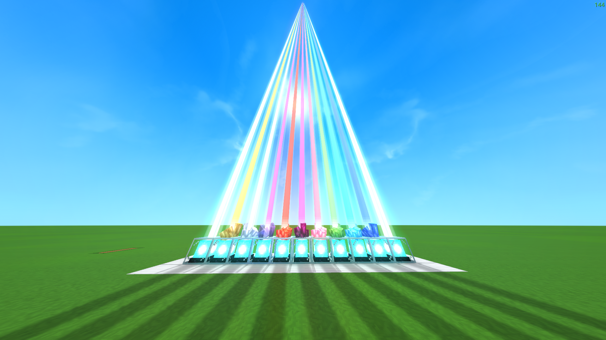
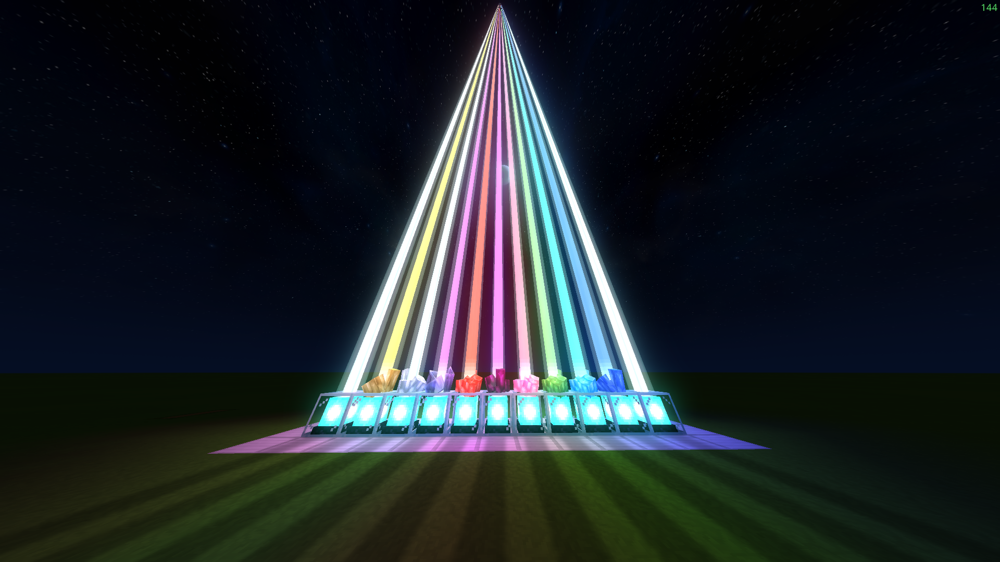
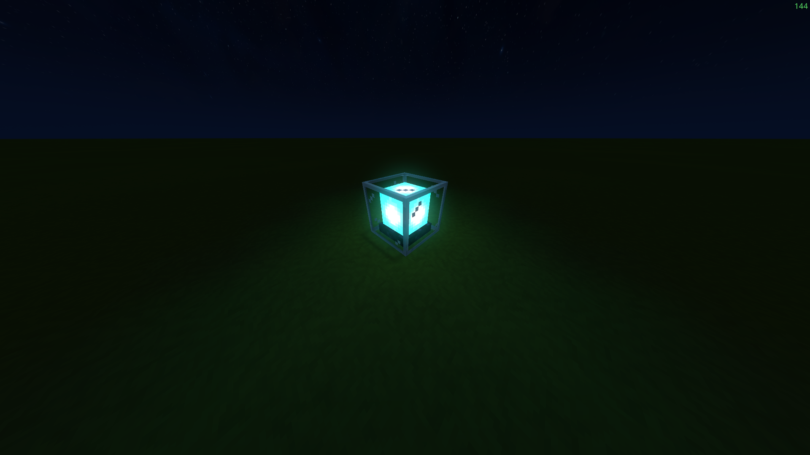
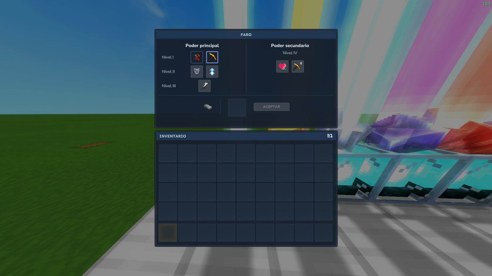
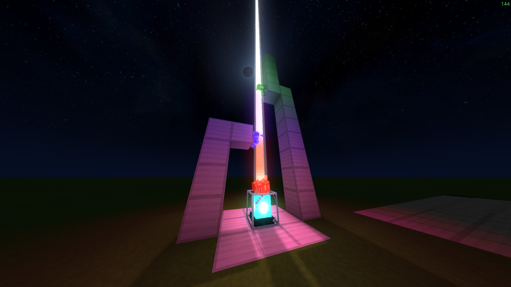
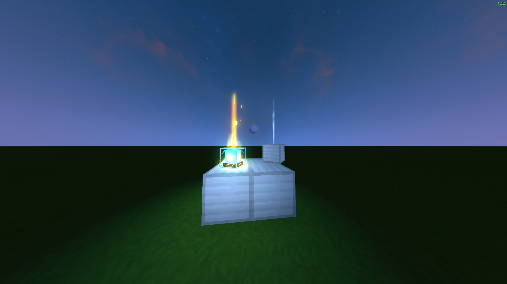
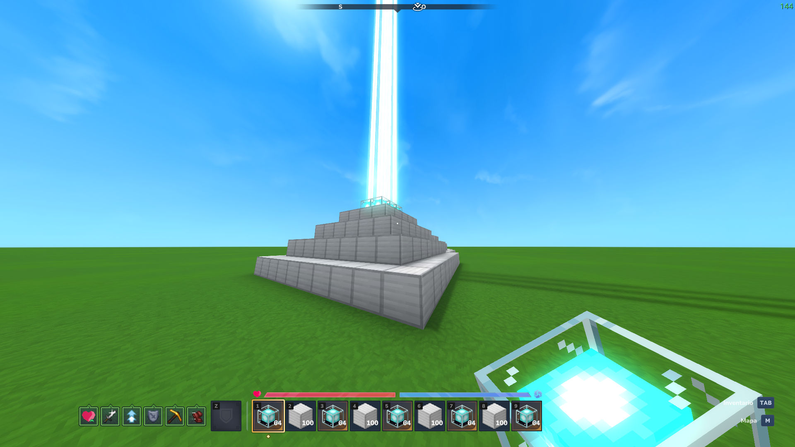

# Definitely Not Beacon

## English

Definitely Not Beacon is a clone of Minecraft's Beacon brought to Hytale:
an adaptation of the original that aims to feel at home in the game.

<table>
   <tr>
      <td></td>
      <td></td>
      <td></td>
      <td></td>
   </tr>
   <tr>
      <td></td>
      <td></td>
      <td></td>
      <td></td>
   </tr>
</table>

### Requirements and installation

Requires **Hytale 0.7.4**, release patchline. Servers need **Java 25**.

1. Close Hytale and stop the server. Copy `DefinitelyNotBeacon-ht0.7.4-0.1.0-beta.jar`
   into `%APPDATA%\Hytale\UserData\Mods` for a local world, or your server's `mods` folder.
2. Enable **Definitely Not Beacon** in the world's Mods settings and start the game.
3. When updating, remove the previous JAR and restart the server and clients.
   Keep only one version installed.

### Crafting

At the **Builder's Workbench**, craft **1 iron block from this mod with 10 iron ingots**.
Hytale's native iron blocks do not count toward the Beacon pyramid.

At the **Arcanist's Workbench**, in **Miscellaneous**, craft **1 Beacon** with:

| Material            | Amount |
| ------------------- | ------ |
| Cyan Crystal Shards | 20     |
| Basalt Brick        | 20     |
| Thorium Ingot       | 8      |
| Essence of Life     | 10     |
| Gobliterator Core   | 1      |

The **Gobliterator** drops the core needed for the recipe. Both the Beacon and
the mod's iron blocks are crafted and stack up to 100.

### Getting started

1. Build a solid **3×3 layer of the mod's iron blocks** and place the Beacon in
   the center on top. Its beam appears when the base is valid.
2. Press **Use** (F by default) to open or close the menu.
3. Drag an ingot into the payment slot, choose an unlocked power and press **ACCEPT**.
   Each new configuration costs one ingot; the remaining deposit is returned.

Closing the menu or disconnecting returns the deposit without changing your
confirmed selection. If your inventory is full, the refund drops beside you.
Confirming the same paid configuration again is free.

### Levels and powers

Expand the pyramid downward with solid, centered layers of 5×5, 7×7 and 9×9.

| Level | Total iron blocks | Radius     | Unlocks                            |
| ----- | ----------------- | ---------- | ---------------------------------- |
| I     | 9                 | 60 blocks  | Speed and Haste                    |
| II    | 34                | 90 blocks  | Resistance and Jump Boost          |
| III   | 83                | 120 blocks | Strength                           |
| IV    | 164               | 150 blocks | Regeneration I or primary power II |

- **Speed:** faster movement and lower sprint stamina consumption.
- **Haste:** more mining progress per pickaxe hit and faster primary attacks.
- **Resistance:** extra physical and projectile protection, plus maximum health.
- **Jump Boost:** stronger jumps and less fall damage.
- **Strength:** more physical melee damage.
- **Regeneration:** restores 2 health per second.

Choose one primary power. At level IV, add Regeneration I or upgrade the primary
to II. The menu tooltips show the values. Range is spherical; effects linger
briefly after leaving it. Overlapping Beacons apply the strongest intensity of
each power, without adding their bonuses together.

Your paid selection survives restarts. Damaging the pyramid suspends powers
that its reduced level cannot support; repairing it restores them without another
payment. Breaking the Beacon itself removes its selection.

### Beam colors

Place small crystals on the Beacon or in the beam's column to tint it. Each
crystal changes the color from its height upward with a smooth transition;
multiple colors mix in the upper sections. White crystals alone keep the original beam.

Crystals follow normal placement rules and cannot be stacked directly. Use side
supports to place them at different heights. The beam does not require a clear path to the sky.

### Compatibility and links

This **BETA-0.1** targets **Hytale 0.7.4**. Other game versions and combinations
with other mods still need testing. The menu supports English and Spanish.

---

## Español

Definitely Not Beacon es un clon del Beacon de Minecraft llevado a Hytale:
una adaptación del original que busca encajar de forma natural en el juego.

### Requisitos e instalación

Requiere **Hytale 0.7.4**, patchline `release`. En servidores se necesita **Java 25**.

1. Cierra Hytale y detén el servidor. Copia `DefinitelyNotBeacon-ht0.7.4-0.1.0-beta.jar`
   en `%APPDATA%\Hytale\UserData\Mods` para una partida local, o en la carpeta `mods` del servidor.
2. Activa **Definitely Not Beacon** en la pestaña Mods del mundo e inicia la partida.
3. Al actualizar, retira el JAR anterior y reinicia el servidor y los clientes.
   Mantén una sola versión instalada.

### Fabricación

En la **Mesa de Trabajo del Constructor**, fabrica **1 bloque de hierro del mod
con 10 lingotes de hierro**. El hierro nativo de Hytale no sirve para la pirámide.

En la **Mesa de Trabajo del Arcanista**, pestaña **Diversos**, fabrica **1 Beacon** con:

| Material            | Cantidad |
| ------------------- | -------- |
| Cyan Crystal Shards | 20       |
| Basalt Brick        | 20       |
| Thorium Ingot       | 8        |
| Essence of Life     | 10       |
| Gobliterator Core   | 1        |

El **Gobliterator** entrega el núcleo necesario para la receta. Tanto el Beacon
como los bloques de hierro del mod se fabrican y se apilan hasta 100 unidades.

### Cómo empezar

1. Construye una capa sólida de **3×3 bloques de hierro del mod** y coloca el
   Beacon centrado encima. El rayo aparece cuando la base es válida.
2. Pulsa **Usar** (F por defecto) para abrir o cerrar el panel.
3. Arrastra un lingote a la ranura de pago, elige un poder desbloqueado y pulsa **ACEPTAR**.
   Cada configuración nueva consume un lingote y devuelve el sobrante del depósito.

Cerrar el panel o desconectarte devuelve el depósito sin cambiar la selección
confirmada. Si el inventario está lleno, la devolución cae junto a ti.
Repetir la configuración ya pagada no consume otro lingote.

### Niveles y poderes

Amplía la pirámide hacia abajo con capas sólidas y centradas de 5×5, 7×7 y 9×9.

| Nivel | Hierro total | Radio       | Desbloquea                    |
| ----- | ------------ | ----------- | ----------------------------- |
| I     | 9 bloques    | 60 bloques  | Velocidad y Prisa             |
| II    | 34 bloques   | 90 bloques  | Resistencia y Salto           |
| III   | 83 bloques   | 120 bloques | Fuerza                        |
| IV    | 164 bloques  | 150 bloques | Regeneración I o principal II |

- **Velocidad:** movimiento más rápido y menor gasto de stamina al correr.
- **Prisa:** más progreso por golpe de pico y mayor cadencia de ataques principales.
- **Resistencia:** protección física y de proyectiles adicional, y más salud máxima.
- **Salto:** mayor impulso al saltar y menos daño por caída.
- **Fuerza:** más daño físico cuerpo a cuerpo.
- **Regeneración:** recupera 2 puntos de vida por segundo.

Elige un poder principal. En nivel IV, añade Regeneración I o sube el principal a II.
Los tooltips muestran los valores. El alcance es esférico y las mejoras duran unos
segundos al alejarte. Si se solapan Beacons, gana la intensidad mayor de cada poder;
los bonos no se suman.

La selección pagada se conserva al reiniciar. Dañar la pirámide suspende los poderes
que su nuevo nivel no permita; repararla los restaura sin otro pago.
Romper el propio Beacon elimina su selección.

### Colores del rayo

Coloca cristales pequeños sobre el Beacon o en la columna del rayo para teñirlo.
Cada cristal cambia el color desde su altura hacia arriba con una transición suave;
varios colores se mezclan en los tramos superiores. Los cristales blancos solos
conservan el rayo original.

Los cristales mantienen las reglas normales de colocación y no se apilan directamente.
Usa apoyos laterales para situarlos a distintas alturas. El rayo no necesita una
columna despejada hacia el cielo.

### Compatibilidad y enlaces

Esta **BETA-0.1** está dirigida a **Hytale 0.7.4**. Otras versiones y combinaciones
con otros mods requieren pruebas. El panel está disponible en español e inglés.
